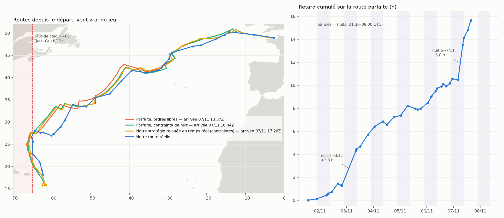

# vr-weather-routing

Weather routing and optimal control for offshore sailing races in **Virtual Regatta** (Ultim class), built and run
live during the Route du Rhum 2026 (Saint-Malo → Guadeloupe, 1–8 November 2026), with a sliding-window extension for
round-the-world races (Vendée Globe).

The router plans what a player can actually do: a few programmed orders (true-wind-angle autopilot), no sail change while
asleep, energy and manoeuvre penalties as in the game, the game's own wind (each GFS bulletin applied six hours after its
cycle), land and forbidden zones checked minute by minute.



## Results in one table
Real-time replay of the full race in the reconstructed game wind, using only the information available at each decision
(details and protocol in [docs/METHOD.md](docs/METHOD.md)):

| Policy (same constraints: 4 programs per day, ≤ 3 orders, sail locked at night) | Arrival (passage line + 2.5 h) |
|---|---|
| Clairvoyant optimum (perfect knowledge of the wind, beam search on exact value) | 07/11 16:04 UTC |
| **This router, replayed in real time** | **07/11 17:26 UTC** (+1.4 h) |
| The route actually sailed during the race (earlier versions of the code) | ≥ 08/11 04:25 UTC |

Without the night constraint the clairvoyant optimum is 13:37 UTC: the human constraints alone are worth ~2.4 h.

## How it works
1. **Value function** — semi-Lagrangian Bellman recursion on a 0.25° grid, 1 h step, state (position, sail, tack), with
   manoeuvre penalties (`bellman_fine.py`); coarse-to-fine variant restricted to the corridor of the routes
   (`bellman_c2f.py`, same values, 2.3× faster); one table per GEFS member and a scenario tree (`bellman_tree.py`).
2. **Program** — beam search over 24 h in the game wind with the full physics (energy, penalties spilling over steps,
   TWA autopilot), the table as terminal cost, the player's constraints; candidates (beam, previous program shifted in
   time, locally refined versions) are compared on a 24 h continuation, then **verified minute by minute** before being
   proposed (`stochastic/beam_prog.py`).
3. **Strategic control** — stochastic beam search with decisions common to all GEFS scenarios, a lagged ensemble (members
   of the previous bulletins) and a Bayesian scenario filter whose temperature is calibrated on past races
   (`stochastic/beam_stoch.py`, `stochastic/calibrate_weights.py`). It flags strategic disagreement; replays showed it
   should not drive the program (see METHOD).
4. **Automation** — at every bulletin: download GFS + GEFS (`stochastic/fetch_ensemble.py`), build the tables, estimate
   the boat position from the last observation and the entered orders, plan, self-test, e-mail the orders
   (`stochastic/auto/auto_update.py`, cron entries in `stochastic/auto/*.sh`). End of race: direct stochastic simulation of
   every program to the finish line (`stochastic/endgame.py`).
5. **Round-the-world extension** — `vendee/window_bellman.py`: Bellman per leg up to the next cape, unwrapped longitudes
   across 180°, Antarctic exclusion zone, climatological terminal value beyond the forecast horizon.

## Repository layout
```
optimal_route.py        boat model: polar, foils/polish, manoeuvres & energy, land mask, forbidden zone, finish
bellman_*.py            value functions (fine grid, coarse-to-fine, per member, tree, non-anticipative)
finish_local.py         fine value of the last miles (around Basse-Terre)
stochastic/             planners (beam_prog, beam_stoch, endgame, earlier optimizers), game wind, downloads
stochastic/auto/        automatic update at each bulletin (cron)
hindsight/              hindsight evaluation: game-wind reconstruction, clairvoyant optimum, real-time replays, figure
vendee/                 sliding-window solver for round-the-world races (course file = example structure)
tests/                  unit, core and regression tests
docs/METHOD.md          problem, model, algorithms, evaluation protocol, results, limitations
```

## Getting started
```bash
python -m venv .venv && . .venv/bin/activate
pip install -r requirements.txt
python -m unittest tests.test_core tests.test_routing tests.test_regression -v   # ~5 s, no data needed
python vendee/window_bellman.py --selftest                                        # ~2 min, synthetic wind
```

### Data
- **Boat polar** (not distributed: third-party data): the Virtual Regatta Ultim polar in the JSON format exported by
  ITYC (`https://ityc.fr/data/export/Ultim_BP_XI.json`), saved as `data/Ultim_BP_XI_current.json` (or set `POLAR_FILE`).
  Tests fall back on a synthetic polar (`tests/fixtures/polar_synthetic.json`).
- **Weather**: NOAA GFS 0.25° and GEFS 0.5° (10 m wind), downloaded by `stochastic/fetch_ensemble.py CYCLE` from NOMADS
  (public domain; NOMADS keeps about ten days). Grids are stored as `data/ens_CYCLE/*3h.npz`.
- **Coastline**: Natural Earth 1:50m land (public domain), `data/land.geojson`.

### Planning by hand
```bash
python stochastic/beam_prog.py CYCLE OBS_UTC LAT LON ENERGY TWA SAIL HOURS ['[[h, twa], ...]']
# e.g. FINISH_REAL=1 BEAM_ORDERS=4 python stochastic/beam_prog.py 2026110712 202611072215 16.71 -62.00 89 58 0 12
```
Output: `BEAM {json}` with the orders (minute, signed TWA, sail), expected time, verification status, and the value of
the program currently entered.

### Automation
Copy `config.env.example` to `config.env` (notification e-mail, parallelism), keep the player state in
`stochastic/auto/state.json` (see `stochastic/auto/state.example.json`), and install the cron lines documented at the top
of `stochastic/auto/prefetch.sh` and `quick.sh`.

## Limitations
- The game model is reconstructed from observation (replay error 1.5–3 % in distance over a night); official forbidden
  zones other than the finish area are not modelled.
- Value tables are relaxations (fixed typical energy, 1 h step): they guide the search but are neither bounds nor ETAs.
- The clairvoyant optimum is the best route found by a pruned beam search, stable to ±2 min across beam size and grid
  resolution, not a certified global optimum.

## License
MIT — see [LICENSE](LICENSE). Weather data: NOAA (public domain). Coastline: Natural Earth (public domain).
